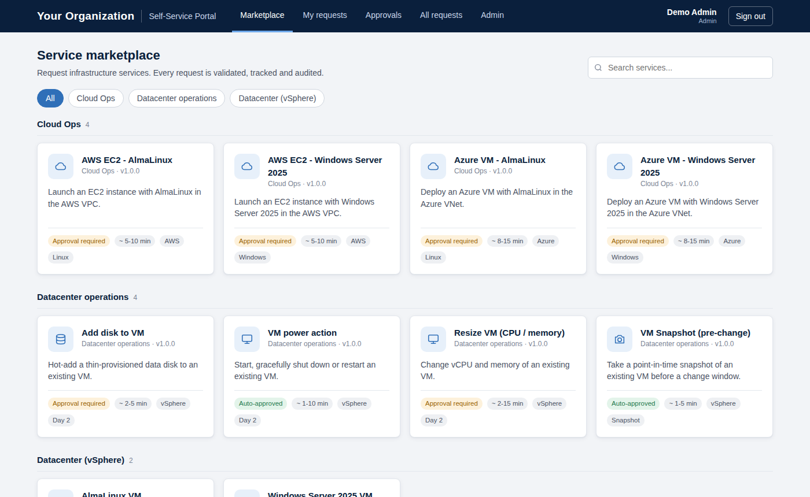
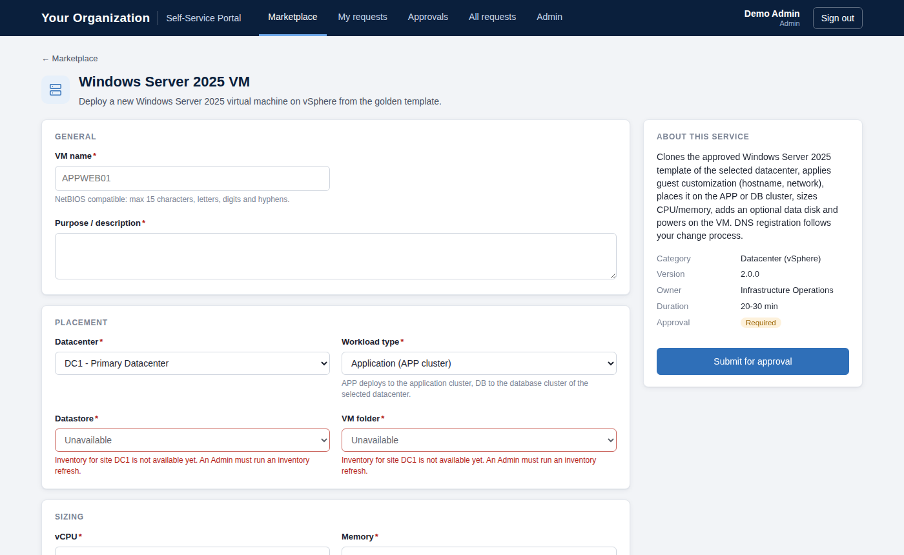
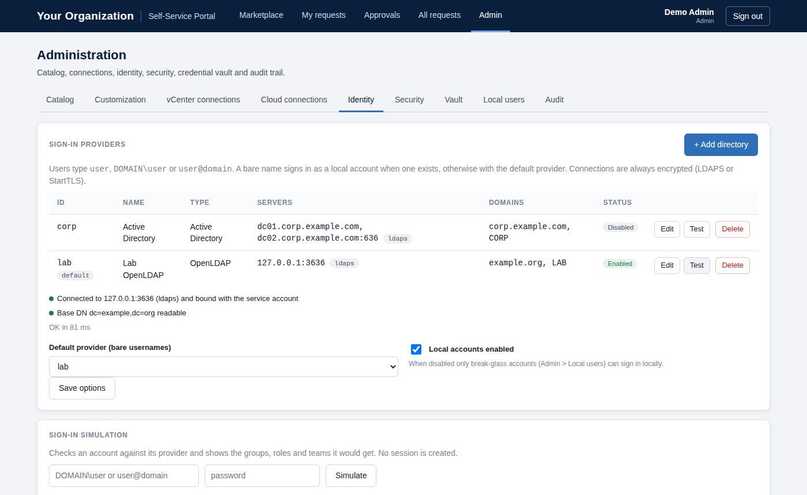
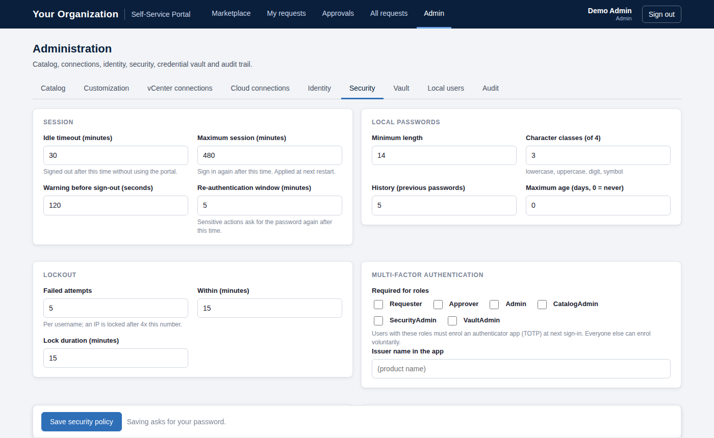
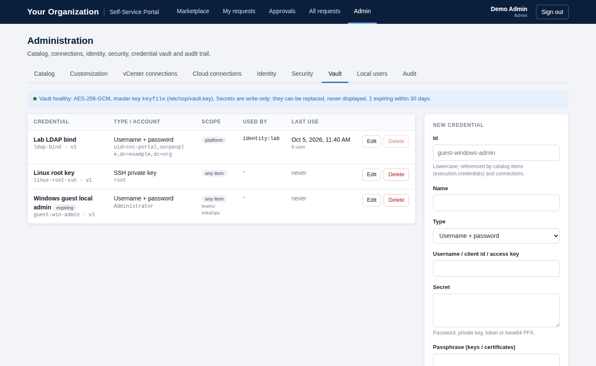

# Self-Service Portal

> **Version 1.0.x (maintenance branch).** This branch holds the 1.0 line of the portal (last release: v1.0.2).
> The current version is on the [`main`](../../tree/main) branch; downloads of every version are on the
> [Releases](../../releases) page.

**A free, community self-service portal for infrastructure teams** (source-available, not for resale). Users request services from a marketplace —
new VMs on VMware vSphere, AWS or Azure, day-2 operations — and the portal validates, routes for approval,
executes the automation and keeps a complete audit trail. Every service is a JSON catalog item plus a PowerShell
script, so adding a service needs no web development and no restart.

  



## Features

| Area | What you get |
|---|---|
| **Service catalog** | JSON items with typed inputs, live lookups from vCenter / AWS / Azure inventory, per-site fixed parameters, VM notes section, validation, hot reload. Visual catalog editor in Admin. |
| **Workflow** | Optional approvals per item, team-scoped approvers, self-approval policy, out-of-process job runner with timeouts, live job log, rollback convention. |
| **Shipped items** | Windows Server 2025 and AlmaLinux VMs on vSphere (template per site, App/DB cluster routing), AWS EC2 and Azure VMs, VM power, add disk, resize, snapshot. |
| **Identity** | Local accounts, Active Directory and OpenLDAP (LDAPS / StartTLS), several directories at once, user@domain / DOMAIN\user routing, group → role and group → team mapping, sign-in simulation. |
| **Security** | TOTP MFA with recovery codes (required for admin roles), password policy, lockout, 30-minute idle timeout with warning, re-authentication for sensitive actions, session revocation, admin networks, separation of duties (Catalog / Security / Vault admins), break-glass accounts, CSRF protection, full audit trail. |
| **Credential vault** | AES-256-GCM vault for automation credentials (vCenter, guests, LDAP bind, cloud, APIs): write-only, scoped to items and teams, versioned, expiry-aware, injected into jobs as `[pscredential]` and masked in logs. |
| **White label** | Product name, organization, logo, colours, login text and footer from Admin > Customization; teams such as Infrastructure / Cloud decide who sees which items. |
| **Deployment** | OVA appliance (AlmaLinux 9, built with Packer, OVF properties for network and passwords), Linux installer (AlmaLinux/RHEL/Rocky 9, Ubuntu 24.04) or Windows Server. |

<table><tr>
<td></td>
<td></td>
</tr><tr>
<td></td>
<td></td>
</tr></table>

## Quick start

### Option 1 — OVA appliance (vSphere)

Build the OVA with Packer ([docs/ova.md](docs/ova.md)), deploy it from the vSphere Client, fill in the vApp properties
(hostname, IP, DNS, NTP, passwords) and open `https://<appliance>/`.

### Option 2 — Linux (AlmaLinux / RHEL / Rocky 9, Ubuntu 24.04)

```bash
tar xzf self-service-portal-1.0.0.tar.gz && cd self-service-portal-1.0.0
sudo ./packaging/linux/install.sh --hostname-cert portal.example.com
```

Installs PowerShell, the modules, a systemd service (`ssp-portal`), a self-signed certificate, the vault key and
firewall rules. Offline (air-gapped) installs are supported. See [docs/installation-linux.md](docs/installation-linux.md).

### Option 3 — Windows Server

```powershell
pwsh -File .\tools\Install-PortalPrerequisites.ps1     # once, elevated
pwsh -File .\Start-Portal.ps1
```

See [docs/installation-windows.md](docs/installation-windows.md) for TLS, the service account and running as a service.

### First sign-in

Sign in with `admin` / `ChangeMe-2026!`. The portal makes you change the password and enrol an authenticator app,
then:

1. **Admin > Identity** — add your Active Directory or OpenLDAP directory and test it.
2. **Admin > Customization** — branding, teams, role-mapping groups, VM notes fields.
3. **Admin > vCenter / Cloud connections** — endpoints and service accounts (stored in the vault).
4. **Admin > Catalog** — replace the `TBD-...` template names in the build items.
5. **Admin > Security** — review session, password, MFA and admin-network policies; disable local accounts except a break-glass one.

## Requirements (summary)

| | Minimum | Recommended |
|---|---|---|
| CPU / RAM / disk | 2 vCPU / 4 GB / 40 GB | 4 vCPU / 8 GB / 60 GB |
| OS | AlmaLinux / RHEL / Rocky 9, Ubuntu 24.04, Windows Server 2019+ | The OVA (AlmaLinux 9) |
| Runtime | PowerShell 7.4, Pode 2.14.x | |
| Automation modules | VMware PowerCLI (vSphere items); AWS.Tools / Az (optional, Cloud Ops) | |
| Network | Inbound 443/tcp; outbound vCenter 443, LDAP 636/389, DNS, NTP, cloud APIs | |

The complete list — service-account permissions for vCenter, AWS IAM and Azure RBAC, certificates, port matrix and a
pre-deployment checklist — is in [docs/requirements.md](docs/requirements.md).

## Documentation

| Topic | Document |
|---|---|
| Everything needed before installing | [Requirements](docs/requirements.md) |
| How it works (components, sign-in, job execution) | [Architecture](docs/architecture.md) |
| Install on Linux / build and deploy the OVA / install on Windows | [Linux](docs/installation-linux.md) · [OVA](docs/ova.md) · [Windows](docs/installation-windows.md) |
| All configuration keys and environment variables | [Configuration](docs/configuration.md) |
| Local accounts, Active Directory, OpenLDAP | [Identity](docs/identity.md) |
| Security model and hardening checklist | [Security](docs/security.md) |
| Credential vault | [Vault](docs/vault.md) |
| Adding services: items, inputs, handlers | [Catalog authoring](docs/catalog-authoring.md) |
| REST API | [API](docs/api.md) |
| Backup, upgrades, logs, monitoring, troubleshooting | [Operations](docs/operations.md) |
| What comes next (21 planned catalog items) | [Roadmap](docs/roadmap.md) |

## Repository layout

```
Start-Portal.ps1          web server entry point (Pode routes)
modules/                  portal logic: catalog, jobs, identity, auth, vault, settings, ...
automation/               job runner, connection tests, inventory, handlers/ (one script per service)
catalog/                  items/*.json, schema, templates
config/                   *.default.json (live config is created at first start)
web/                      single-page UI (plain JavaScript, no build step)
tools/                    CLI helpers (prerequisites, local users, endpoint, catalog validation)
packaging/                Linux installer, systemd unit, OVA build (Packer, kickstart, first boot)
tests/                    offline smoke tests (+ optional live LDAP tests)
docs/                     documentation
```

## Testing

```powershell
pwsh -File ./tests/Invoke-SmokeTest.ps1
```

About 180 offline checks — catalog, roles and teams, workflow and runner, vault, password policy, lockout, sessions,
TOTP (RFC 6238 vectors), permissions, identity routing and migrations — plus live LDAP checks when a test directory is
configured. CI runs them on Linux and Windows ([.github/workflows/ci.yml](.github/workflows/ci.yml)).

## Status

Version 1.0.2. The engine, UI, identity layer (verified against OpenLDAP over LDAPS and StartTLS) and vault are
covered by automated tests; integration with production vCenter, Active Directory and cloud tenants must be validated
in your environment — start with a lab site. Planned work is in the [roadmap](docs/roadmap.md).

## Contributing, security and license

- Contributions are welcome — see [CONTRIBUTING.md](CONTRIBUTING.md) and the [code of conduct](CODE_OF_CONDUCT.md).
- Report vulnerabilities privately — see [SECURITY.md](SECURITY.md).
- Licensed under the [Apache License 2.0 with the Commons Clause](LICENSE): free to use, modify and share, but it may not be sold (no resale, paid hosting, support or consulting based on it). Provided as is, without support. Third-party components: [THIRD_PARTY_NOTICES.md](THIRD_PARTY_NOTICES.md).

VMware, vSphere, Active Directory, Azure, AWS and AlmaLinux are trademarks of their respective owners. This project is
not affiliated with or endorsed by them.
