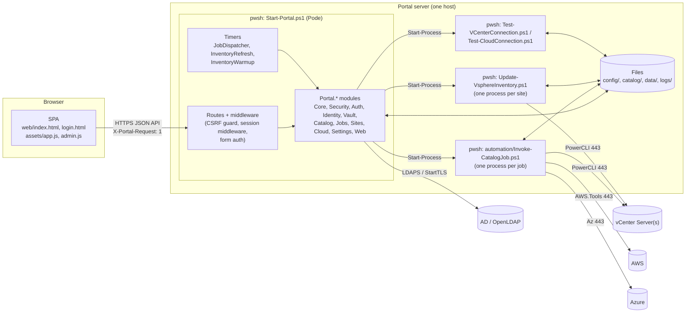
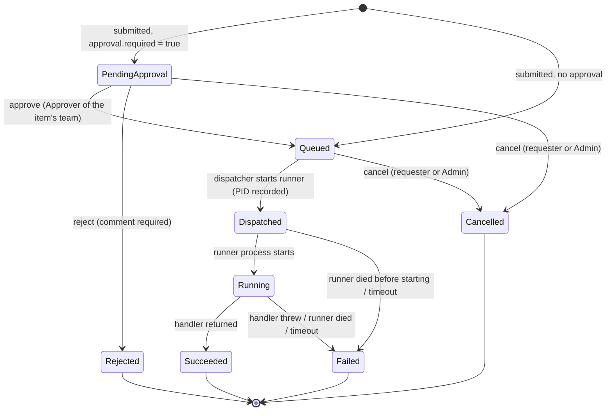
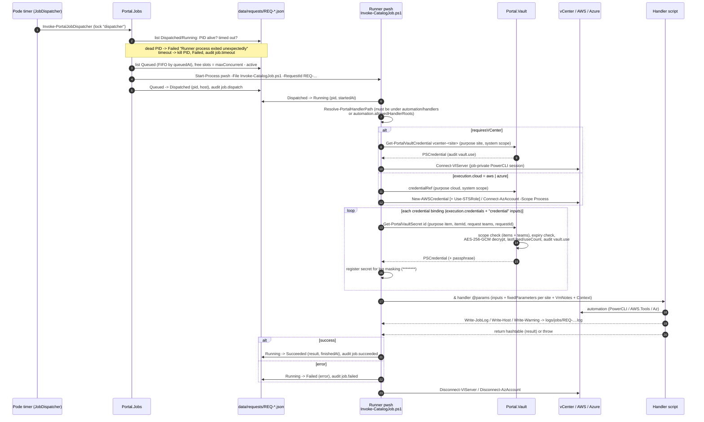
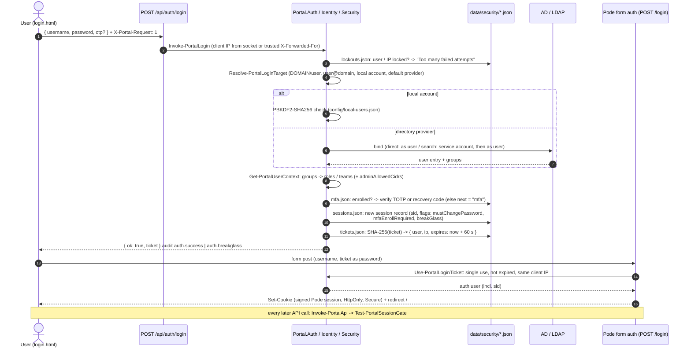

# Architecture

This document describes how the Self-Service Portal is built: its components, how a request moves from submission to execution, how sign-in and sessions work, where state is stored and how concurrent writers are serialised, what each PowerShell module does, and the main design decisions. It is meant for operators who need to troubleshoot the portal and for contributors who change it. Configuration keys are described in [configuration.md](configuration.md); the security model in depth is in [security.md](security.md).

## Contents

1. [Overview](#1-overview)
2. [Components](#2-components)
3. [Request lifecycle](#3-request-lifecycle)
4. [Job execution](#4-job-execution)
5. [Sign-in and sessions](#5-sign-in-and-sessions)
6. [Data layout](#6-data-layout)
7. [Concurrency and locking](#7-concurrency-and-locking)
8. [Module map](#8-module-map)
9. [Web front-end](#9-web-front-end)
10. [Configuration bootstrap and migrations](#10-configuration-bootstrap-and-migrations)
11. [Design decisions](#11-design-decisions)

---

## 1. Overview

The portal is one PowerShell 7 process running a [Pode](https://badgerati.github.io/Pode/) web server (`Start-Portal.ps1`, 8 threads). It serves a static single-page application and a JSON API. Every catalog item is a JSON file in `catalog/items/`; a submitted request becomes a JSON document in `data/requests/`, optionally waits for approval, and is then executed **out-of-process** by a separate `pwsh` process that runs the item's handler script from `automation/handlers/`. There is no database and no build step.

## 2. Components

| Component | Process | Responsibility |
|---|---|---|
| Web server | `pwsh Start-Portal.ps1` (long-running) | HTTPS endpoint, static files, JSON API, sign-in, session gate, authorization, catalog rendering and validation, approvals, administration, timers |
| Job dispatcher | Pode timer `JobDispatcher` in the web server, every `jobs.dispatcherIntervalSeconds` (default 10 s) | Reconciles running jobs (crash, timeout) and starts queued jobs up to `jobs.maxConcurrent` |
| Job runner | `pwsh automation/Invoke-CatalogJob.ps1 -RequestId <id>` (one per job) | Opens the vCenter / cloud session, resolves vault credentials, runs the handler, records the result |
| Inventory collector | `pwsh automation/Update-VsphereInventory.ps1 -Site <code>` (one per enabled site) | Writes a vCenter snapshot (`data/inventory/<SITE>.json`) that feeds the form drop-downs. Started by the `InventoryRefresh` timer (`inventory.refreshIntervalMinutes`), once 20 s after start-up (`InventoryWarmup`), after a successful vCenter *Test connection* and on demand from Admin. |
| Connection tests | `pwsh automation/Test-VCenterConnection.ps1` / `Test-CloudConnection.ps1` | Admin *Test connection*; run out-of-process with the same identity as the jobs, so a green result means jobs can authenticate too |
| Handlers | `automation/handlers/*.ps1` (or folders in `automation.allowedHandlerRoots`) | The automation itself; one parameter per catalog input |

All child processes are started with `Start-Process` using `jobs.pwshPath`, inherit the portal's environment (including `SSP_PORTAL_ROOT`, `SSP_VAULT_KEYFILE`) and identity, and redirect their console output to `logs/jobs/<name>.stdout.log` / `.stderr.log`.

## 3. Request lifecycle

A request is created by `POST /api/requests` after server-side validation of every input (`Test-PortalRequestInput`: types, patterns, ranges, and every select / credential value re-checked against its option list). The state machine is enforced by `Update-PortalRequest` in `modules/Portal.Jobs.psm1`; any other transition throws.

| Rule | Implementation |
|---|---|
| Who may approve | `Test-PortalCanApprove`: status is `PendingApproval`; the user holds one of `approval.approverRoles` (default `Approver`, `Admin`); the user belongs to one of the request's teams (Admins see all teams); not the requester unless `auth.allowSelfApproval`; a **VaultAdmin** may not approve a request that uses vault credentials unless `security.separationOfDuties.vaultAdminCanApprove`. |
| Re-authentication | Items with `security.requireReauth` ask for the password (and MFA code) again on submission and on approval. |
| Cancel | Only `PendingApproval` and `Queued` requests. A running job cannot be cancelled from the portal (not supported yet). |
| Snapshot | At submission the request stores a copy of the execution contract (`handler`, `requiresVCenter`, `cloud`, `fixedParameters`, `credentials`, credential inputs, VM-note labels, `timeoutMinutes`, `requireReauth`, `teams`). Later edits of the catalog item do not change queued requests. |
| History | Every transition appends `{ ts, status, actor, note }` to `history`; workflow actions are also written to `logs/audit.jsonl`. |
| Visibility | Requesters see their own requests; Approvers and Admins see the requests of their teams (`Assert-PortalRequestVisible`). The API never returns the execution contract to the browser (`Get-PortalRequestView`). |

Request ids have the form `REQ-yyyyMMdd-XXXXXX` (UTC date, 6 hex digits) and are validated against that pattern before any file access.

## 4. Job execution

Handler contract (enforced by the runner and by the catalog validator):

- Parameters are bound by **name**: the item's input names plus the keys of `execution.fixedParameters` (per-site maps such as `{ "DC1": "TPL-A", "*": "default" }` are resolved for the selected site). Only parameters the handler declares are passed.
- `-Context` (if declared) receives `RequestId`, `Requester`, `Site` (site configuration), `VIServer` (connected session or `$null`), `Cloud` (AWS / Azure context or `$null`), `RollbackOnFailure` (`jobs.rollbackOnFailure`) and `PortalRoot`.
- `-VmNotes` (if declared and the item has VM notes) receives an ordered dictionary `Label = value`.
- Vault bindings become `[pscredential]` parameters; decrypted secrets never reach the browser and are masked in the job log.
- The last hashtable / object the handler outputs is stored as `result` and shown to the requester; throwing fails the job.

Authoring details are in [catalog-authoring.md](catalog-authoring.md); the vault model in [vault.md](vault.md).

## 5. Sign-in and sessions

Sign-in is a two-step exchange so that every check (lockout, directory, roles, MFA) runs in a normal JSON endpoint, while the session cookie is still issued by Pode's own form authentication.

**Per-request session gate.** Each API route calls `Invoke-PortalApi`, which rebuilds the user context from the identity captured at sign-in (role mapping and admin networks are re-evaluated on every call) and runs `Test-PortalSessionGate`:

| Check | Result |
|---|---|
| Session record missing or ended (logout, revoke) | 401 `SESSION_EXPIRED` / `SESSION_REVOKED` |
| `lastActivity` older than `security.session.idleTimeoutMinutes` | record ended, 401 `SESSION_IDLE` |
| `loginAt` older than `security.session.absoluteTimeoutMinutes` | record ended, 401 `SESSION_EXPIRED` |
| `mustChangePassword` (local account) | 403 `PASSWORD_CHANGE_REQUIRED`, except on self-service endpoints |
| `mfaEnrollRequired` (role in `security.mfa.requiredRoles` and no authenticator) | 403 `MFA_ENROLLMENT_REQUIRED`, except on self-service endpoints |
| Sensitive action and `reauthAt` older than `security.session.reauthWindowMinutes` | 401 `REAUTH_REQUIRED`; the SPA asks for the password (and MFA code) and calls `POST /api/session/reauth` |

Requests carrying `X-Portal-Background: 1` (automatic refreshes) do not count as activity, so polling cannot keep an idle session alive. Then the route's role or permission is checked (`catalog.manage`, `security.manage`, `vault.manage`, `connections.manage`, `audit.read`).

**Cookie.** `Enable-PodeSessionMiddleware` signs the cookie with the secret from the environment variable named by `portal.sessionSecretEnvVar` (default `SSP_SESSION_SECRET`). Without it, Pode uses a random secret per start and every session is lost at restart. The cookie lifetime is the absolute timeout read **at start-up** and is not extended; the server-side record is authoritative.

**Sign-out.** The SPA calls `POST /api/session/logout` (ends the server record, audit `session.logout`) and then posts to Pode's `/logout`, which clears the cookie. Administrators can revoke sessions in Admin > Security.

Identity providers and routing rules are described in [identity.md](identity.md); lockout, MFA and policy in [security.md](security.md).

## 6. Data layout

Paths are relative to the portal root (`/opt/ssp` on Linux, the extraction folder on Windows).

| Path | Content | Written by |
|---|---|---|
| `config/portal.config.json` | Live configuration | Admin pages, migrations, `tools/Set-PortalEndpoint.ps1` |
| `config/local-users.json` | Local accounts (PBKDF2 hashes) | Admin > Local users, `tools/Set-PortalLocalUser.ps1` |
| `config/*.default.json` | Shipped defaults, copied at first start | Release |
| `config/_backup/portal.config.<yyyyMMddHHmmss>.json` | Copy of the previous configuration before **every** change | `Update-PortalConfig` |
| `catalog/items/*.json` | Catalog items | Admin > Catalog, administrators |
| `catalog/_archive/` | Previous versions and deleted items (never hard-deleted) | Catalog editor, migrations |
| `catalog/schema/`, `catalog/_templates/` | JSON schema and item template | Release |
| `automation/handlers/` | Handler scripts (`_*.ps1` are templates, hidden from the editor) | Release, administrators, *Create script skeleton* |
| `data/requests/REQ-*.json` | One document per request (inputs, approval, execution snapshot, job, result, error, history) | Web server, runners |
| `data/inventory/<SITE>.json` | vCenter inventory snapshot | Inventory collector |
| `data/inventory/<SITE>.status.json` | Last inventory run (state, pid, error) | Web server, collector |
| `data/inventory/<SITE>.conn.json`, `cloud-<aws\|azure>.conn.json` | Last *Test connection* result | Connection tests |
| `data/vault/vault.json` | Encrypted credential vault (entries, versions, key check) | Vault |
| `data/vault/master.key` / `master.key.dpapi` | Vault master key, when the `keyfile` provider uses the default path / the `dpapi` provider is used. Linux installs keep the key in `/etc/ssp/vault.key` instead. | Vault |
| `data/security/sessions.json` | Server-side session records (ended sessions are purged after one day) | Portal.Auth |
| `data/security/lockouts.json` | Failed sign-in counters and locks per user (`u:<name>`) and IP (`ip:<addr>`) | Portal.Auth |
| `data/security/mfa.json` | TOTP seeds (encrypted with the vault master key), last used step, hashed recovery codes | Portal.Auth |
| `data/security/tickets.json` | Pending sign-in tickets (SHA-256 of the ticket, 60 s) | Portal.Auth |
| `data/brand/logo.<png\|jpg\|webp>` | Uploaded logo | Admin > Customization |
| `logs/portal.log` | Portal log (`<timestamp> [LEVEL] message`) | All processes |
| `logs/audit.jsonl` | Audit trail, one JSON object per line | All processes |
| `logs/jobs/REQ-*.log` | Job log shown in the request page | Runner (`Write-JobLog`) |
| `logs/jobs/*.stdout.log`, `*.stderr.log` | Console output of every child process (jobs, `inventory-<SITE>`, `conntest-<SITE>`, `conntest-cloud-<provider>`) | Child processes |
| `logs/pode-errors_*.log`, `logs/pode-requests_*.log` | Pode error and request logs (not written with `-ShowErrors`, which logs errors to the console) | Pode |

Every JSON write is atomic: the document is written to a temporary file in the same folder and moved over the target (`Write-PortalJson`).

## 7. Concurrency and locking

The web server runs 8 Pode threads plus timers, and runner processes update the same files. All read-modify-write operations run inside `Invoke-PortalLock`, a **named, cross-process mutex** (`Global\SspPortal_<name>`, default wait 30 s; an abandoned mutex from a crashed process is taken over).

| Lock name | Protects |
|---|---|
| `req-<REQ-id>` | One request document (state transitions) |
| `dispatcher` | One dispatcher pass at a time (5 s wait; a pass that cannot get the lock is skipped) |
| `config` | `portal.config.json` (`Update-PortalConfig`) |
| `local-users` | `local-users.json` |
| `catalog` | Catalog item writes |
| `vault` | `vault.json` |
| `auth-sessions`, `auth-lockout`, `auth-mfa`, `auth-tickets` | The files in `data/security/` |
| `audit`, `portal-log` | Appends to `logs/audit.jsonl` and `logs/portal.log` |

Named mutexes are local to the host, so two portal instances sharing one data folder (for example on a network share) are **not** protected against each other.

The configuration is cached per runspace and re-read automatically when the file's modification time changes, so changes made by the Admin pages, by the tools or by hand are picked up without a restart (exceptions in [configuration.md](configuration.md#5-live-settings-and-settings-that-need-a-restart)).

## 8. Module map

Modules are loaded by `Start-Portal.ps1` into the web server; job runners load only what they need.

| Module | Loaded by | Purpose |
|---|---|---|
| `modules/Portal.Core.psm1` | everything | Paths (`Get-PortalPath`), configuration cache, atomic JSON I/O, `Invoke-PortalLock`, `Write-PortalLog`, `Write-PortalAudit`, error flattening, allowed handler roots and handler path resolution, per-site values, workload-to-cluster mapping. Must not depend on Pode. |
| `modules/Portal.Security.psm1` | web, runner, tools | Roles and permissions, `Get-PortalUserContext` (groups to roles/teams, role inheritance, admin network restriction), local accounts (PBKDF2-SHA256, 210,000 iterations), password policy and history, effective security policy with defaults, teams. |
| `modules/Portal.Vault.psm1` | web, runner, tools | Credential vault: AES-256-GCM, key providers (`keyfile`, `dpapi`, `env`, `auto`), entries and versions, scope enforcement, audited secret retrieval, reference tracking, legacy CliXml migration, `Protect-PortalSecretValue` (used for MFA seeds). |
| `modules/Portal.Identity.psm1` | web, tools | AD / OpenLDAP providers via `System.DirectoryServices.Protocols`: flavor defaults, login routing, LDAPS / StartTLS / negotiate, direct and search bind, nested / memberOf / search group resolution, error mapping, *Test connection*, provider CRUD. |
| `modules/Portal.Auth.psm1` | web, tools | Sign-in orchestration, client IP (trusted proxies), lockout, TOTP (RFC 6238) enrolment and verification, recovery codes, session records, session gate, tickets, re-authentication. |
| `modules/Portal.Catalog.psm1` | web, tools | Catalog loading and validation (also used by `tools/Test-CatalogItem.ps1`), VM-notes section injection, option lookups (sites, inventory, cloud lists, vault entries), server-side input validation, catalog editor (save, archive), handler inspection and skeleton creation. |
| `modules/Portal.Jobs.psm1` | web, runner | Request store and state machine, approval rules, dispatcher, child-process start, inventory refresh orchestration and status. |
| `modules/Portal.Sites.psm1` | web, tools | `Update-PortalConfig` (locked write with backup), vCenter site settings and credentials, out-of-process vCenter connection test, `Initialize-PortalConfiguration` (first run and migrations). |
| `modules/Portal.Cloud.psm1` | web, tools | AWS / Azure connection settings (whitelisted keys), secret storage in the vault, out-of-process connection test, cloud lookups for the forms. |
| `modules/Portal.Settings.psm1` | web, tools | Branding, teams, role mapping, VM-notes fields, policies, security policy validation, logo upload, team-scope migration. |
| `modules/Portal.Web.psm1` | web | `Invoke-PortalApi` (session gate, role / permission checks, uniform error mapping with reference ids), request visibility and view projection. |
| `automation/lib/Portal.Vsphere.psm1` | runner, inventory, tests | vCenter credential retrieval (`Vault`, `SecretManagement`, `CliXml`) and `Connect-PortalVIServer` (session-scoped PowerCLI settings, certificate and proxy policy, actionable error hints). |
| `automation/lib/Portal.CloudConnect.psm1` | runner, tests | AWS (access key or default chain, optional assume-role) and Azure (service principal or managed identity) authentication for handlers. |

## 9. Web front-end

- Static files in `web/`: `index.html` (application shell), `login.html` (sign-in page with its own inline script), `assets/app.js` (requester / approver views, session handling), `assets/admin.js` (Admin tabs), `assets/branding.js` (applies colours, names and logo), `assets/portal.css`, `assets/vendor/qrcode.js` (QR code for MFA enrolment, bundled locally).
- Vanilla JavaScript, no framework, no build step, no external CDN. Hash routes: `#/catalog`, `#/requests`, `#/approvals`, `#/all`, `#/admin`, `#/account`.
- Every state-changing call sends `X-Portal-Request: 1`; the `PortalCsrfGuard` middleware rejects non-GET `/api/*` calls without it (403). `/api/*` responses carry `Cache-Control: no-store`.
- Forms are generated from the catalog item definition returned by `GET /api/catalog/:id`; dependent drop-downs call `POST /api/catalog/:id/options/:input`. The browser never receives handler names, fixed parameters or vault secrets.
- Admin tabs are shown according to the permissions returned by `GET /api/me`: Catalog, Customization, vCenter connections, Cloud connections, Identity, Security, Vault, Local users, Audit.
- An idle-warning dialog uses `GET /api/session` timers; sign-out is propagated to other tabs with `BroadcastChannel` where available.

The API is documented in [api.md](api.md).

## 10. Configuration bootstrap and migrations

At every start, before the server listens, `Start-Portal.ps1` runs:

1. `Initialize-PortalConfiguration` - copies `config/portal.config.default.json` and `config/local-users.default.json` to their live names when missing (first run), then upgrades an existing configuration non-destructively: adds missing sections (`automation`, `auth.localUsers`, `clouds`, `teams`, `branding`, `vmNotes`, `auth.providers`, `security`, `vault`, new role names in `roleMapping`, `workloadClusters`), converts the legacy Windows-AD sign-in (`auth.fqdn` / `auth.domain`) into an LDAP provider, moves `portal.sessionDurationMinutes` to `security.session.absoluteTimeoutMinutes`, and archives retired example items. Each change is backed up in `config/_backup/` and audited as `config.upgrade`.
2. `Initialize-PortalTeamScopes` - once: scopes existing catalog items and local users to teams.
3. `Import-PortalLegacySecrets` - moves DPAPI CliXml credentials of sites and clouds into the vault (Windows), renaming the old files to `*.migrated`.
4. `Get-PortalVaultStatus` - creates or validates the vault master key.

One-time migrations are recorded by id in `_migrations` and never run twice (see [configuration.md](configuration.md#313-_migrations)). A fresh configuration ships with every id already recorded.

## 11. Design decisions

| Decision | Rationale | Consequence |
|---|---|---|
| PowerShell + Pode, no database, no build step | Infrastructure teams can read and extend every part; PowerCLI, AWS.Tools and Az are first-class | Single host; JSON files must be backed up as files ([operations.md](operations.md)) |
| JSON catalog + handler scripts | A new service is one JSON file plus one script; files are read on demand, so no restart | The validator checks items against their handler's `param()` block at load time; invalid items are hidden and reported in Admin > Catalog |
| Out-of-process jobs | Isolates PowerCLI sessions and module state per job, contains crashes and memory, allows hard timeouts (process kill) | Each job costs a `pwsh` start (seconds) and 150-300 MB. Under systemd, restarting the service also terminates running jobs (they belong to the service's control group); the dispatcher then marks them `Failed`. |
| Atomic writes + named mutexes | Consistency between web threads and runner processes without a database | Host-local only; no active/active deployment |
| Two-step sign-in with a one-time ticket | All checks (lockout, LDAP, MFA) in a JSON endpoint with precise messages, while Pode still owns the cookie | The ticket is bound to the client IP and valid 60 s; reverse proxies must be listed in `trustedProxies` |
| Server-side session records | Idle timeout, revocation, forced password change, MFA enrolment and re-authentication independent of the signed cookie | `data/security/sessions.json` is a hot file; sessions survive restarts only with a fixed session secret |
| Roles recomputed per request | Role-mapping and admin-network changes apply immediately | Directory group membership itself is captured at sign-in |
| Write-only vault with scopes | Secrets are created through the UI but only decrypted in runners / connection tests, and every use is audited | Losing the master key loses every secret and every MFA enrolment ([vault.md](vault.md)) |
| Handler roots allow-list | Catalog editors cannot point an item at an arbitrary script | Custom folders must be added to `automation.allowedHandlerRoots` |
| Ignore vCenter certificate errors by default | Works out of the box with VMCA self-signed certificates | Set `invalidCertificateAction: Fail` once the CA is trusted ([security.md](security.md)) |
