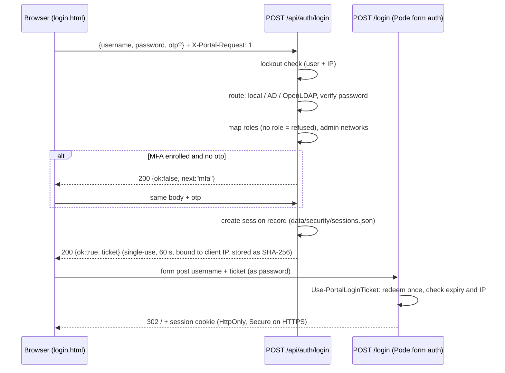

# Security model and hardening guide

This document describes how the Self-Service Portal protects sign-in, sessions, administration and automation credentials, and how to harden a production deployment. It reflects the code in `modules/Portal.Auth.psm1`, `Portal.Security.psm1`, `Portal.Web.psm1`, `Portal.Settings.psm1`, `Portal.Jobs.psm1` and `Start-Portal.ps1`. The automated checks are in `tests/Invoke-SmokeTest.ps1` (sections *Password policy*, *Sign-in, lockout and sessions*, *MFA (TOTP)*, *Permissions and networks*, *Vault*).

Related documents: [identity.md](identity.md) (sign-in providers), [vault.md](vault.md) (credential vault), [api.md](api.md) (endpoints), [architecture.md](architecture.md), [configuration.md](configuration.md), [operations.md](operations.md).

## Contents

- [Threat model summary](#threat-model-summary)
- [Authentication flow](#authentication-flow)
- [Generic error messages](#generic-error-messages)
- [Lockout](#lockout)
- [Password policy](#password-policy)
- [Multi-factor authentication (TOTP)](#multi-factor-authentication-totp)
- [Sessions](#sessions)
- [Re-authentication for sensitive actions](#re-authentication-for-sensitive-actions)
- [Authorization](#authorization)
- [Admin networks](#admin-networks)
- [Separation of duties](#separation-of-duties)
- [CSRF protection](#csrf-protection)
- [Input validation](#input-validation)
- [Handler confinement](#handler-confinement)
- [Audit trail](#audit-trail)
- [Secrets handling](#secrets-handling)
- [Production hardening checklist](#production-hardening-checklist)
- [Known limitations](#known-limitations)

---

## Threat model summary

| Asset | Why it matters |
|---|---|
| Vault secrets (vCenter, cloud, directory bind, guest credentials) | Grant privileged access to infrastructure |
| Vault master key | Decrypts every vault secret and every MFA seed |
| Administrative functions (catalog, identity, security policy, vault) | Change who can do what and what the automation runs |
| Job execution (handlers run as the service account with vault credentials) | Changes production infrastructure |
| Audit trail | Accountability |

| Threat | Main controls |
|---|---|
| Password guessing and credential stuffing | Lockout per user and per IP, generic messages, MFA, PBKDF2 for local passwords |
| Stolen password | MFA (TOTP) required for administrative roles |
| Session theft or an unattended browser | Server-side session registry, idle and absolute timeouts, revocation, HttpOnly/Secure cookie, re-authentication for sensitive actions |
| Cross-site request forgery | `X-Portal-Request` header required on state-changing API calls |
| Tampered requests (forged select values, foreign vault ids) | Server-side re-validation of every input |
| Privilege concentration | Split admin roles (`CatalogAdmin`, `SecurityAdmin`, `VaultAdmin`), team-scoped approvals, vault separation of duties, admin networks |
| Arbitrary script execution through catalog items | Handlers confined to allowed folders and run out of process |
| Secret disclosure through the UI, API or logs | Write-only vault, masking in job logs, no secrets in API responses |
| Lost key or tampered vault file | AES-256-GCM with associated data and a key check value. Key backup is the operator's responsibility. |

**Out of scope.** An attacker with administrative access to the portal host. Such an attacker can read the master key and the data directory, change the code, or run as the service account. The trust placed in handler scripts. Protect the host ([checklist](#production-hardening-checklist)) and review handler code like any other privileged automation.

## Authentication flow

Sign-in is a two-step exchange. All checks run in a JSON API call. The resulting single-use ticket is then exchanged for the Pode session cookie.

- Step 1 failures return `401 {ok:false, message}`. Unexpected errors return `500` with "Sign-in is temporarily unavailable".
- In step 2, a ticket that is unknown, already used, expired (after 60 s) or presented from another client IP fails, and Pode redirects to `/login?error=1`.
- The password never reaches the Pode form scheme: the browser posts only the ticket.

## Generic error messages

- Wrong passwords, unknown users, unknown domains and unexpected LDAP errors all return the same message: **"Invalid username or password."** The smoke test checks that an unknown user and a wrong password get identical messages.
- Exceptions: directory account states that the user must act on are shown as such (locked, expired, must change, disabled), and so is "directory not reachable" (see [identity.md](identity.md#10-troubleshooting)). These messages disclose that a directory account exists, which is a deliberate usability trade-off.
- Wrong local passwords incur an 800 ms delay, and a user not found in search-bind mode a 300 ms delay. Response times are **not** uniform: see [Known limitations](#known-limitations).
- An account with no portal role gets "Your account is not authorised for this portal (no role assigned)." This message appears only after a correct password.

## Lockout

Policy: `security.lockout` (Admin > Security).

| Setting | Default | Range |
|---|---|---|
| `threshold` | 5 failures | 3 to 50 |
| `windowMinutes` | 15 | 1 to 1440 |
| `durationMinutes` | 15 | 1 to 1440 |

- Failures are counted per **username** (key `u:<bare name, lower-case>`: `CORP\jdoe`, `jdoe@corp.example.com` and `jdoe` share it) and per **client IP** (key `ip:<address>`). The IP threshold is **4 × threshold** (20 by default), to tolerate several users behind one NAT or proxy.
- These count as failures: wrong passwords, wrong MFA codes, failed re-authentication, and directory errors other than "unavailable". Directory outages (`unavailable`) do not count.
- While locked, even a correct password is refused: "Too many failed attempts. Try again in N minute(s)."
- A successful sign-in clears the user counter.
- Locks are listed in **Admin > Security** and can be cleared there (`POST /api/admin/security/lockouts/clear`, audited as `security.unlock`) or with `tools/Set-PortalLocalUser.ps1 -Username <name> -Unlock`.
- State: `data/security/lockouts.json`.

## Password policy

Policy: `security.password`. It applies to **local accounts only**: directory passwords are governed by the directory.

| Setting | Default | Range | Rule |
|---|---|---|---|
| `minLength` | 14 | 8 to 128 | Minimum number of characters |
| `requireClasses` | 3 | 1 to 4 | Character classes among lowercase, uppercase, digit and symbol |
| `history` | 5 | 0 to 24 | The new password must differ from the last N |
| `maxAgeDays` | 0 (never) | 0 to 3650 | Older passwords force a change at sign-in |
| (fixed) | | | Must not contain the username (case-insensitive) |

- A password set by an administrator, through the UI, the API or the CLI, sets `mustChangePassword`. Until the owner changes it, every API call except account self-service returns `403 PASSWORD_CHANGE_REQUIRED`, and the UI redirects to *My account*.
- Self-service change (`POST /api/me/password`) requires the current password and a different new password.
- Hashing: PBKDF2-HMAC-SHA256, 210,000 iterations, 16-byte random salt, constant-time comparison.

## Multi-factor authentication (TOTP)

| Property | Value |
|---|---|
| Algorithm | RFC 6238 TOTP, HMAC-SHA1, 6 digits, 30-second step, 160-bit random secret |
| Accepted window | Current step ±1 (about ±30 s) |
| Replay protection | The last accepted step is stored (`lastStep`). A code from the same or an earlier step is rejected. |
| Seed storage | Encrypted with the **vault master key** (AES-256-GCM, associated data bound to the user) in `data/security/mfa.json` |
| Recovery codes | 10 single-use codes (`xxxx-xxxx`), shown once, stored as SHA-256 hashes. Using one is audited as `mfa.recoverycode.used`. |
| Required roles | `security.mfa.requiredRoles`, default `Admin`, `SecurityAdmin`, `VaultAdmin`. Matched against the **effective** roles, so `Admin` is always covered when any role is listed. |
| Issuer | `security.mfa.issuer`, by default the portal name |

**Enrolment** (*My account*):

1. `POST /api/me/mfa/begin` returns the base32 secret and an `otpauth://` URI, which the UI shows as a QR code. The pending secret expires after 15 minutes. Replacing an existing authenticator requires [re-authentication](#re-authentication-for-sensitive-actions).
2. `POST /api/me/mfa/confirm {code}` verifies a code, activates the secret, returns the 10 recovery codes and clears the session's enrolment flag.

Users whose role requires MFA and who are not enrolled can sign in, but every API call except account self-service returns `403 MFA_ENROLLMENT_REQUIRED` until they enrol. Users with other roles can enrol voluntarily. Once enrolled, they always need a code.

**Reset.** A `SecurityAdmin` or `Admin` resets a user's authenticator in **Admin > Security** (directory users) or **Admin > Local users > Edit** (local users). This uses `POST /api/admin/security/mfa/reset`, requires re-authentication, also ends the user's sessions, and is audited as `mfa.reset`. CLI: `Set-PortalLocalUser.ps1 -Username <name> -ResetMfa` (local accounts).

**Time synchronisation is required.** The server clock and the phones must agree within about 30 s. Run NTP or chrony on the portal host.

MFA depends on the vault master key. If the key is replaced, enrolled users cannot sign in until their MFA is reset (see [vault.md](vault.md#8-backup-and-master-key-rotation)).

## Sessions

The portal combines Pode's cookie session with its own **server-side session registry** (`data/security/sessions.json`), which is checked on every API call (`Test-PortalSessionGate`).

| Control | Behaviour | Setting (default, range) |
|---|---|---|
| Idle timeout | No user activity for N minutes ends the session (`401 SESSION_IDLE`) | `security.session.idleTimeoutMinutes` (30, 5 to 120) |
| Background polls | Requests with `X-Portal-Background: 1` (approval counter, status refresh) do **not** count as activity | |
| Absolute timeout | The session ends N minutes after sign-in, whatever the activity (`401 SESSION_EXPIRED`) | `security.session.absoluteTimeoutMinutes` (480, 30 to 1440) |
| Warning | The UI shows "Are you still there?" N seconds before the idle sign-out, with *Stay signed in* (keepalive) or *Sign out* | `security.session.warningSeconds` (120, 30 to 600) |
| Cross-tab sign-out | Activity and sign-out are broadcast to every tab of the same browser (`BroadcastChannel`) | |
| Revocation | Admin > Security > Active sessions > *End session*, by short session id or by user (`401 SESSION_REVOKED`). Deleting a local user or resetting MFA also ends that user's sessions. | |
| Forced actions | `403 PASSWORD_CHANGE_REQUIRED` / `403 MFA_ENROLLMENT_REQUIRED` until resolved | |
| Cookie | Pode session cookie, `HttpOnly`. `Secure` when the endpoint is HTTPS (not with `-Http`). Lifetime = absolute timeout, not extended. | |

- Sign-out: the UI calls `POST /api/session/logout` (marks the registry entry ended) and then posts to Pode's `/logout`.
- Session records that ended more than a day ago are purged at the next sign-in.
- Policy changes apply immediately to the registry checks. The Pode cookie lifetime is read only at start-up, so a new absolute timeout applies to the cookie after a restart.

**Restart behaviour.** Pode keeps session data in memory (no custom storage is configured). A portal restart therefore signs every user out, even when `SSP_SESSION_SECRET` is set. The secret signs the session cookie. Set it anyway, to a long random value: the Linux installer and the OVA generate one in `/etc/ssp/portal.env`. Without it, Pode uses a random secret per start, and the start-up warning reminds you.

## Re-authentication for sensitive actions

Sensitive actions require a password (and MFA code, when enrolled) entered within the last `security.session.reauthWindowMinutes` (default 5, range 1 to 60). Otherwise the API returns `401 REAUTH_REQUIRED`. The UI then shows *Confirm it's you*, calls `POST /api/session/reauth`, and retries. Signing in, a self-service password change and MFA enrolment all reset the window.

| Endpoint | Condition |
|---|---|
| `POST /api/admin/users` | always |
| `DELETE /api/admin/users/:username` | always |
| `POST /api/admin/identity` | always |
| `DELETE /api/admin/identity/:id` | always |
| `POST /api/admin/identity/options` | always |
| `POST /api/admin/security/policy` | always |
| `POST /api/admin/security/mfa/reset` | always |
| `POST /api/admin/vault` | always |
| `DELETE /api/admin/vault/:id` | always |
| `POST /api/admin/settings` | when the body contains `roleMapping` or `policies` |
| `POST /api/me/mfa/begin` | when an authenticator is already enrolled (replacement) |
| `POST /api/requests` | when the catalog item has `security.requireReauth: true` or any input has `requireReauth: true` |
| `POST /api/requests/:id/approve` | when the request was submitted from such an item (stored in the request snapshot) |
| `POST /api/catalog/:id/options/:input` | when that input has `requireReauth: true` |
| `POST /api/admin/sites` | when a vCenter password is included |
| `POST /api/admin/clouds` | when a cloud secret is included |
| `POST /api/admin/users` / `DELETE /api/admin/users/:username` | always |

Failed re-authentication counts toward lockout and is audited as `auth.reauth.failed`. Success is audited as `auth.reauth`.

## Authorization

Roles are described in [identity.md](identity.md#5-roles-and-teams). `Admin` implies every role, and `Approver` implies `Requester`. Administrative endpoints check **permissions**:

| Permission | Roles | Admin tabs |
|---|---|---|
| `catalog.manage` | `Admin`, `CatalogAdmin` | Catalog, Customization (branding, teams, VM notes) |
| `security.manage` | `Admin`, `SecurityAdmin` | Identity, Security, Local users, Customization (role mapping, policies) |
| `vault.manage` | `Admin`, `VaultAdmin` | Vault |
| `connections.manage` | `Admin` | vCenter connections, Cloud connections (and inventory) |
| `audit.read` | `Admin`, `SecurityAdmin` | Audit |

- The UI shows only the tabs the user's permissions allow (`GET /api/me` returns `permissions`). The server enforces every permission independently and returns `403 Insufficient permissions.` otherwise.
- `GET /api/admin/settings` requires `catalog.manage` or `security.manage`. `POST /api/admin/settings` checks each section: `roleMapping` and `policies` need `security.manage`, everything else needs `catalog.manage`.
- Catalog items are visible when `enabled`, the user has one of `access.roles` (default `Requester`, `Approver`, `Admin`) and shares a team with `access.teams` (empty = everyone, `Admin` sees all). Hidden items return `404`.
- Requests: requesters see their own. Approvers and Admins see requests of their teams (`404` otherwise). An approver can decide only when they hold one of the item's `approval.approverRoles` (default `Approver`, `Admin`), share a team with the request, are not the requester (unless `auth.allowSelfApproval`), and pass [separation of duties](#separation-of-duties).
- Role mapping matches group **CNs**. Restrict who can create or rename groups under the group search base (`groupBaseDn`), because a group with a mapped CN grants that role.

## Admin networks

`security.adminAllowedCidrs` (IPv4/IPv6 CIDRs or single addresses, empty = anywhere) limits the **administrative roles** (`Admin`, `CatalogAdmin`, `SecurityAdmin`, `VaultAdmin`) to management networks. It is evaluated on every request against the client IP:

- Outside the networks, those roles are removed for the request. Roles implied only by `Admin` disappear too. Admin endpoints answer `403 ... Administrative roles are only available from the management network.` A user whose only role is administrative cannot sign in from outside.
- **Anti-lockout:** saving a list that does not contain the caller's current address is rejected ("saving would lock you out of administration"). Admin > Security displays your address.
- `security.trustedProxies`: `X-Forwarded-For` is honoured only when the TCP peer is in this list, and then its **left-most** address is used as the client IP. Configure the reverse proxy to overwrite, not append to, an `X-Forwarded-For` header received from clients. Client IPs drive lockout, ticket binding, admin networks and the audit trail.

## Separation of duties

- A user holding `VaultAdmin` (assigned directly, or through `Admin`, which implies it) cannot approve a request that uses vault credentials, through `execution.credentials` or a `credential` input, unless `security.separationOfDuties.vaultAdminCanApprove` is `true` (default `false`). The custodian of the credentials does not approve their use; such requests need an `Approver` without vault rights.
- `CatalogAdmin` can bind a vault entry to an item only if the entry's scope (managed by `VaultAdmin`) allows that item ([vault.md](vault.md#4-scope)).
- Self-approval is off by default (`auth.allowSelfApproval`).

## CSRF protection

- Middleware on `/api/*` rejects every non-GET request without the header `X-Portal-Request: 1` (`403 {"error":"Missing anti-forgery header."}`). A cross-site page cannot set a custom header without a CORS preflight, and the portal does not enable CORS.
- `/login` (ticket redemption) and `/logout` are Pode form routes outside `/api/*`. The single-use, IP-bound ticket protects `/login`. `/logout` has no anti-forgery check, so a third-party page can sign a user out.
- `/api/*` responses carry `Cache-Control: no-store`. When the installed Pode version provides `Set-PodeSecurity`, the portal enables its `Simple` security-header preset.

## Input validation

- Every request is re-validated on the server (`Test-PortalRequestInput`). Required fields, numbers (min/max), IPv4, length and regex patterns are checked. Every `select` **and** `credential` value is checked against the option list the server computes (static options, inventory, cloud settings, or in-scope vault entries). Inputs hidden by `visibleWhen` are dropped. Errors return `422` with a field map.
- Administrative inputs are validated before saving: identity providers, vault entries, local users, security policy ranges, CIDRs, branding colours, team ids and catalog definitions. Free-text values in branding, providers and vault metadata cannot contain `<` or `>`. The UI escapes all output.
- Logos: PNG, JPEG or WebP only (no SVG), 512 KB maximum.
- LDAP filter values are escaped according to RFC 4515.

## Handler confinement

- `execution.handler` must be a `.ps1` file under `automation/handlers` or a folder listed in `automation.allowedHandlerRoots`. A bare file name resolves to `automation/handlers`. `Resolve-PortalHandlerPath` enforces this when an item is saved and again in the job runner at run time.
- Jobs run **out of process** (`pwsh automation/Invoke-CatalogJob.ps1 -RequestId ...`) under the portal service account. Only parameters that the handler declares are passed.
- `CatalogAdmin` can create handler **skeletons** from a fixed template (`POST /api/admin/handlers/stub`) but cannot upload code through the portal. Control write access to the handler folders at the file-system level.

## Audit trail

- Append-only JSON Lines file: `logs/audit.jsonl`. Each line has `{ts, actor, action, target, details}`, with timestamps in UTC.
- Covered: sign-in (`auth.success`, `auth.breakglass`, `auth.failed`, `auth.locked`, `auth.norole`, `auth.mfa.failed`, `auth.reauth`, `auth.reauth.failed`), sessions (`session.logout`, `session.revoke`), MFA (`mfa.enrolled`, `mfa.reset`, `mfa.recoverycode.used`), the request lifecycle (`request.*`, `job.*`), administration (`catalog.*`, `handler.create`, `settings.*`, `security.policy.update`, `security.unlock`, `localuser.*`, `identity.*`, `site.*`, `cloud.*`, `inventory.refresh`, `config.upgrade`) and the vault (`vault.save`, `vault.delete`, `vault.use`, `vault.migrate`).
- **Admin > Audit** (`audit.read`) shows the latest 200 entries. Ship the file to your SIEM for retention and integrity: it is not signed or hash-chained.

## Secrets handling

| Secret | Storage |
|---|---|
| Automation and platform credentials | Vault: AES-256-GCM, write-only, scoped, use audited ([vault.md](vault.md)) |
| MFA seeds | Encrypted with the vault master key |
| Local passwords | PBKDF2-HMAC-SHA256 (210,000 iterations) |
| Login tickets | SHA-256 hash only, 60-second lifetime |
| Recovery codes | SHA-256 hash only |
| Session secret, vault key file path | Environment (`SSP_SESSION_SECRET`, `SSP_VAULT_KEYFILE`). On Linux, in `/etc/ssp/portal.env` (`root:ssp 0640`). |
| Job logs | Decrypted secrets are replaced by `********` in `logs/jobs/<id>.log` (see the limits in [vault.md](vault.md#7-job-log-masking)) |

## Production hardening checklist

- [ ] **TLS certificate** from your CA. Linux: `portal.certificateFile` / `certificateKeyFile` ([installation-linux.md](installation-linux.md#8-tls-certificate-replacement)). Windows: `portal.certificateThumbprint` in `LocalMachine\My` ([installation-windows.md](installation-windows.md)). Never run with `-Http` or the self-signed lab certificate.
- [ ] **`SSP_SESSION_SECRET`** set to a long random value (64 hex characters as generated by the installer), readable only by the service account.
- [ ] **Directory sign-in** over LDAPS (or StartTLS) with `tls.verify: true` and a correct CA bundle. No `security: "none"` and no `allowInsecure`.
- [ ] **Local accounts disabled** (`auth.localUsers.enabled: false`) except one or two `breakGlass` accounts with long unique passwords, kept in a safe and monitored (`auth.breakglass` events).
- [ ] Change the default `admin` password (`ChangeMe-2026!`), or delete the account after creating a break-glass one.
- [ ] **MFA** required for at least `Admin`, `SecurityAdmin` and `VaultAdmin`. Consider `Approver` too. Recovery codes stored offline.
- [ ] **NTP** on the portal host (TOTP depends on it).
- [ ] **Admin networks** (`adminAllowedCidrs`) set to the management networks. **`trustedProxies`** set only to your reverse proxies.
- [ ] Split administration: dedicated groups for `CatalogAdmin`, `SecurityAdmin` and `VaultAdmin`. Keep `Admin` for a small group. Keep `vaultAdminCanApprove: false` and `allowSelfApproval: false`.
- [ ] Restrict who can create or rename groups under `groupBaseDn`.
- [ ] **Vault master key**: back it up separately from the data backups and restrict access to the backup ([vault.md](vault.md#8-backup-and-master-key-rotation)). Test a restore.
- [ ] **Least-privilege service accounts**: a read-only LDAP bind account, vCenter roles limited to what the handlers need, cloud identities limited to the landing zone, and vault entries scoped to explicit items rather than `*`.
- [ ] Review handler code and control write access to `automation/handlers` and to `allowedHandlerRoots`.
- [ ] Forward `logs/audit.jsonl` to a SIEM. Alert on `auth.breakglass`, `auth.locked`, `mfa.reset`, `security.policy.update`, `vault.save` and `vault.delete`.
- [ ] **Appliance / OS hardening**: follow [ova.md](ova.md#7-appliance-hardening-summary) (SELinux enforcing, firewall limited to the portal port, SSH restricted, auditd, security updates) and [installation-linux.md](installation-linux.md) (service sandboxing, file modes). On Windows, run the portal as a dedicated, non-administrative service account and restrict the portal folder to that account and administrators ([installation-windows.md](installation-windows.md)). With the `dpapi` key provider, the vault key is bound to that account.

## Known limitations

Verified against the current code. Track planned work in [roadmap.md](roadmap.md).

| Area | Limitation |
|---|---|
| LDAP TLS on Linux | `libldap` reads `LDAPTLS_CACERT` / `LDAPTLS_REQCERT` once per process. One CA bundle and one verification policy apply to every provider, `tls.verify: false` on one provider disables verification for all, and changes need a restart ([identity.md](identity.md#62-process-wide-caveat)). |
| Sessions and restarts | Pode session data is kept in memory. A restart signs everyone out, even with `SSP_SESSION_SECRET`. The session registry, lockouts, MFA and ticket stores are files under `data/security`, protected by host-local named mutexes, so **running several portal nodes behind a load balancer is not supported**. |
| Timing | Unknown and existing local accounts cost the same (a dummy PBKDF2 verification plus the 800 ms delay). Directory sign-ins take as long as the directory takes, so local versus directory routing can still be inferred. |
| Lockout keys | The user counter is keyed on the bare name (`jdoe`, `CORP\jdoe` and `jdoe@corp.example.com` share one counter), so the same uid in two directories shares a counter. Directory lockout policies remain the primary control for directory accounts. |
| Active sessions after account changes | Groups and local roles are captured at sign-in. Disabling a local account, changing its roles or resetting its password ends its sessions; removing a directory group does not (revoke in Admin > Security). |
| Re-authentication coverage | Ending sessions, clearing lockouts, saving catalog items and running the sign-in simulation do not ask for re-authentication. |
| Sign-in simulation | Not subject to lockout. It is restricted to `security.manage` and audited. |
| `/logout` | No anti-forgery check (logout CSRF). |
| Audit trail | Local file, no integrity protection. The UI shows only the latest 200 entries. |
| Job log masking | Covers `logs/jobs/<id>.log` only, and only exact matches of the secret and passphrase ([vault.md](vault.md#7-job-log-masking)). |
| API clients | No API tokens or service accounts for machine-to-machine use: the API is designed for the bundled UI ([api.md](api.md)). |
| Vault master key | No rotation ([vault.md](vault.md#8-backup-and-master-key-rotation)). |
